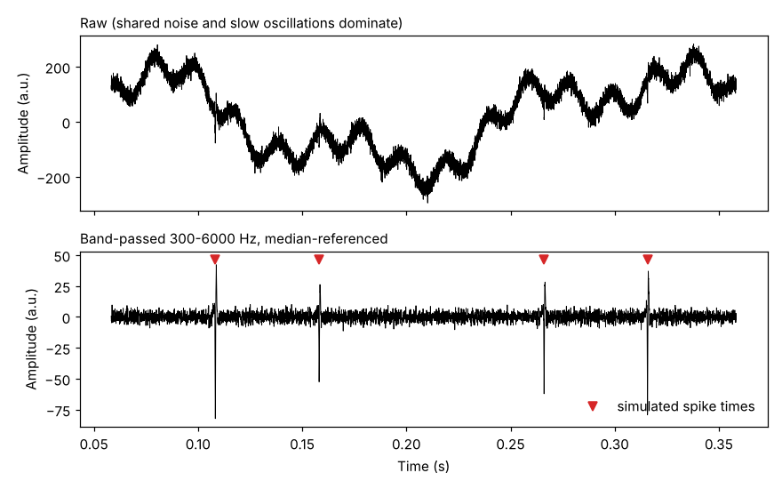
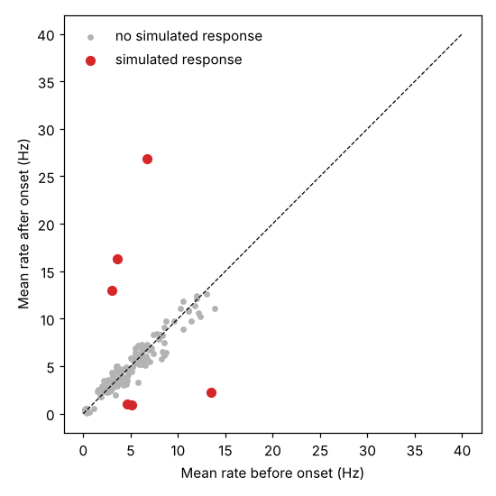
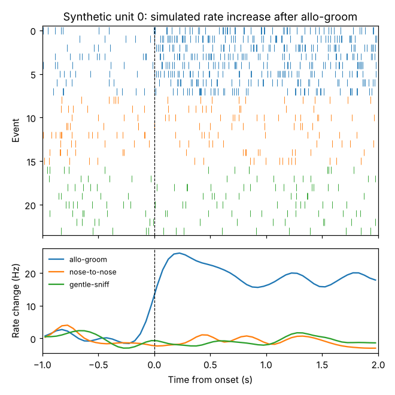

# ephys-behavior-sync

Preprocessing, synchronization and analysis of single-unit recordings with behavior: clean a multichannel signal, put behavior annotations on the neural clock, and test which units respond to which behaviors. The demo and the tests run on simulated recordings with a known ground truth, so every step can be checked against the right answer. No real data are included.

```
raw multichannel signal ──► band-pass + median reference ──► (spike sorting, external)
digital triggers ─────────► clock offset ──┐
behavior annotations ─────► events table ──┴─► event times on the neural clock
sorted spike times + event times ──► PSTH / raster, event-locked responsivity per unit
```

## Demo on simulated data

`python scripts/run_demo.py` generates a session with 20 units and 64 behavior events. Six of the units were simulated to increase or decrease their firing after one behavior. The script runs the pipeline and checks the result against what was simulated:

```
sync: first frame at 22.7392 s on the neural clock (truth 22.7392 s, error 0.015 ms)
events: 64 onsets in 8 (subject, behavior) pairs
responsivity, raw p < 0.05: 6 of 6 simulated responses found; 4 false positives among 154 tests without a simulated response
responsivity, Holm-corrected: 6 of 6 simulated responses found; 0 false positives
```

**1. Preprocessing.** One channel before and after cleaning. Shared noise and slow oscillations are removed, and the putative spikes stay.



**2. Responsivity.** Each point is one unit and one (subject, behavior) combination. Its position is the unit's mean firing rate before onset (x) and after onset (y), averaged over events. Points on the dashed line did not change. Red points are the six combinations with a simulated response, three increases above the line and three decreases below it. Grey points are the 154 combinations without one.



**3. Raster and PSTH.** One unit with a simulated increase after one behavior. Top: each row is one event and each tick is one spike, aligned to onset. Bottom: the average change in firing rate, one curve per behavior. Only allo-groom (blue) evokes a response.



## Quickstart

Requires Python 3.10 or newer.

```bash
git clone https://github.com/RoniGerbi/ephys-behavior-sync.git
cd ephys-behavior-sync
python -m venv .venv
.venv\Scripts\activate            # macOS / Linux: source .venv/bin/activate
pip install -e ".[dev]"
python scripts/run_demo.py        # figures go to ./outputs
pytest                            # run the tests
```

## Modules

| Module | What it does |
|---|---|
| `preprocessing` | Band-pass filter (300-6000 Hz) that keeps the frequencies where spikes live without shifting them in time; median referencing, which removes noise shared by all channels; one rounding step to int16 at the end. Works on arrays with one row per channel and one column per time sample. |
| `sync` | Edge detection on one bit of a digital-input stream; clock offset from the first trigger pulse; annotation times to the neural clock. |
| `events` | Validation of a behavior-annotation table (labels, START/STOP pairing) and onset times per (subject, behavior). |
| `responsivity` | Paired test of firing rate before vs. after each event onset, per unit and per (subject, behavior). |
| `psth` | Peri-event time histograms and raster plots. |
| `synthetic` | Generators for raw signals, digital pulses and full sessions with known ground truth. |

All times are in seconds, and time-valued names end in `_s`. Functions take arrays and tables and never read files or globals.

## Methods at a glance

- **Responsivity.** For each event, the firing rate in the 1 s before onset is compared with the 2 s after onset, with a paired t-test across events (at least 3 events per subject and behavior). The significance threshold and the multiple-comparison correction (none, Holm or FDR) are parameters; the default is raw p < 0.05.
- **Slow units.** A unit is flagged slow, separately for each subject and behavior, when its mean rate is below 1 Hz both before and after onset. Slow rows are never reported as responsive.
- **PSTH.** 50 ms bins, window from -1 s to +2 s, baseline subtraction using the bins before onset, and Gaussian smoothing with sigma = 2 bins.

## Assumptions

- The neural clock and the acquisition clock do not drift measurably over a recording of about 40 minutes, so one trigger pulse defines the offset. If more pulses are available, they are only used to warn about drift.
- Video frames are acquired at a constant rate, and annotation time zero is the first frame, so the first frame time maps annotation time onto the neural clock.

## Layout

```
src/ephys_behavior_sync/   the package
scripts/                   run_demo.py
docs/figures/              figures used in this README
tests/                     tests on simulated data with known answers
```

## Citation

_To be added._

## Acknowledgements

The experiments were performed in the lab of Dr. Anan Moran, Department of Neurobiology, School of Neurobiology, Biochemistry & Biophysics, The George S. Wise Faculty of Life Science, Tel Aviv University.
